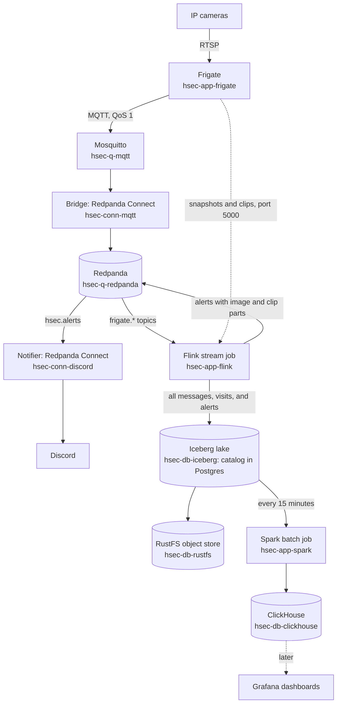
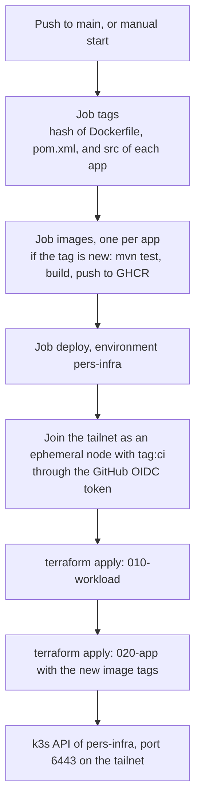

# Home security

A home security system that runs on one k3s node. Frigate watches the IP cameras and finds people, cars, and faces. Each alert goes to Discord at once with a snapshot image, and the video follows in clip parts. Every message also goes into an Iceberg lake, and every 15 minutes Spark turns it into stats in ClickHouse for dashboards. Terraform deploys everything, and the data stays for 30 days at most.

## Contents

- [How it works](#how-it-works)
- [Apps](#apps)
- [Repository layout](#repository-layout)
- [Before you start](#before-you-start)
- [Deploy](#deploy)
- [Continuous deployment](#continuous-deployment)
- [Check the system](#check-the-system)
- [Test](#test)
- [Documents](#documents)
- [Status](#status)

## How it works



1. Frigate reads each camera, detects objects on the Intel UHD 620, and keeps the video of alerts and detections for 14 days.
2. Frigate publishes every event to Mosquitto. The bridge copies each message into its Redpanda topic and adds a video reference: the camera and a time range.
3. The Flink job removes duplicates, writes all messages to Iceberg tables, and builds visits of people.
4. When Frigate marks a review as an alert, Flink sends message 1 with a 720-pixel snapshot. When the review ends, Flink sends the review video in clip parts of up to 25 seconds.
5. The notifier posts these messages to Discord, the image first and then the clip parts.
6. Every 15 minutes, Spark reads the Iceberg tables and writes five stats tables to ClickHouse. Every night, it also deletes old data and compacts the tables.

## Apps

Each app folder holds the code, the configuration, the tests, and a Terraform module in `terraform/`. Its `README.md` has the details and the base knowledge of its technology.

| Folder | Role | Technology | Terraform root |
| --- | --- | --- | --- |
| [hsec-app-frigate](hsec-app-frigate/README.md) | Records the cameras and detects objects and faces | Frigate 0.18.0 | `020-app` |
| [hsec-q-mqtt](hsec-q-mqtt/README.md) | MQTT broker between Frigate and the bridge | Mosquitto 2.1.2 | `010-workload` |
| [hsec-conn-mqtt](hsec-conn-mqtt/README.md) | Copies MQTT messages into Redpanda, with video references | Redpanda Connect 4.112.0 | `020-app` |
| [hsec-q-redpanda](hsec-q-redpanda/README.md) | Message log of all Frigate messages and alerts, 7 days | Redpanda 26.2.3 | `010-workload` |
| [hsec-conn-discord](hsec-conn-discord/README.md) | Posts alerts to Discord | Redpanda Connect 4.112.0 | `020-app` |
| [hsec-app-flink](hsec-app-flink/README.md) | Stream job: tables, visits, and alerts | Flink 2.2.1, Flink Kubernetes Operator 1.16.1 | `020-app` |
| [hsec-db-iceberg](hsec-db-iceberg/README.md) | Iceberg catalog and table migrations | Iceberg 1.12.0, Postgres 18.6 | `010-workload` |
| [hsec-db-rustfs](hsec-db-rustfs/README.md) | Object store of the lake and the Flink checkpoints | RustFS 1.0.1 | `010-workload` |
| [hsec-app-spark](hsec-app-spark/README.md) | Batch job: stats every 15 minutes, nightly cleanup | Spark 4.0.4, Spark Operator 2.5.2 | `020-app` |
| [hsec-db-clickhouse](hsec-db-clickhouse/README.md) | Stats for the dashboards, 29 days | ClickHouse 26.3.39.7 (LTS) | `010-workload` |

Three Terraform roots exist. `010-workload` and `020-app` call the modules, and the deploy workflow applies them. You apply `000-cicd` by hand, once.

| Root | Creates | README |
| --- | --- | --- |
| `terraform/000-cicd` | The identity and the kubeconfig of the deploy workflow | [README](terraform/000-cicd/README.md) |
| `terraform/010-workload` | The namespace `hsec`, passwords, Secrets, network policies, the data services, and the schema migration Jobs | [README](terraform/010-workload/README.md) |
| `terraform/020-app` | Frigate, the bridge, the notifier, Flink, and Spark | [README](terraform/020-app/README.md) |

## Repository layout

```text
home-security/
├── README.md                 # this file
├── .github/
│   ├── workflows/deploy.yml  # CI/CD: build the images and apply Terraform
│   └── scripts/              # apply script and its test
├── docs/
│   ├── system-design.md      # top-level design, decisions, budgets
│   └── specs.md              # detailed specs
├── terraform/
│   ├── 000-cicd/             # root 0: identity of the deploy workflow
│   ├── 010-workload/         # root 1: base and data services
│   └── 020-app/              # root 2: apps
├── hsec-app-frigate/         # Frigate seed configuration and module
├── hsec-q-mqtt/              # Mosquitto configuration, ACL, and module
├── hsec-conn-mqtt/           # bridge pipeline, tests, and module
├── hsec-q-redpanda/          # topics script and module
├── hsec-conn-discord/        # notifier pipeline, tests, and module
├── hsec-app-flink/           # Maven project, Dockerfile, module, and job chart
├── hsec-db-iceberg/          # Iceberg migrations, migrate.sh, and Postgres module
├── hsec-db-rustfs/           # RustFS module
├── hsec-app-spark/           # Maven project, Dockerfile, module, and job chart
└── hsec-db-clickhouse/       # ClickHouse configuration, users, migrations, and module
```

## Before you start

The system needs a single-node k3s cluster on the Fedora host, with the Intel UHD 620, an SSD storage class, and an HDD storage class. The full list is in [Prerequisites](docs/system-design.md#prerequisites).

The admin machine needs these tools:

- Terraform 1.16 and kubectl, with a kubeconfig that has cluster-admin rights.
- Docker with `buildx`, Java 17 or newer, and Maven, to build the two images.
- An image registry that the cluster can pull from, and a Discord webhook URL.

`terraform/010-workload` runs the schema migrations as Kubernetes Jobs. To run a migration by hand, you also need golang-migrate 4.20.1 for ClickHouse, or Spark 4.0.4 for Iceberg. See [Migrate](hsec-db-clickhouse/README.md#migrate) in the ClickHouse README and [Migrate](hsec-db-iceberg/README.md#migrate) in the Iceberg README.

## Deploy

On a fresh cluster, do these steps in order. Run each command from the repository root.

1. Copy `terraform/010-workload/terraform.tfvars.example` to `terraform/010-workload/terraform.tfvars`, and fill in the values.
2. Apply the first root. It creates the base and the data services, and runs the ClickHouse and Iceberg migrations.

   ```sh
   (cd terraform/010-workload && terraform init && terraform apply)
   ```

3. Test and build the two custom images, then push them to your registry.

   ```sh
   (cd hsec-app-flink && mvn test) && (cd hsec-app-spark && mvn test)
   docker buildx build --platform linux/amd64 -t <registry>/hsec-app-flink:<tag> --push hsec-app-flink/
   docker buildx build --platform linux/amd64 -t <registry>/hsec-app-spark:<tag> --push hsec-app-spark/
   ```

4. Copy `terraform/020-app/terraform.tfvars.example` to `terraform/020-app/terraform.tfvars`. Fill in the values, with the same registry and tags as the images that you pushed.
5. Apply the second root. It installs the apps.

   ```sh
   (cd terraform/020-app && terraform init && terraform apply)
   ```

Each root keeps its state in a Kubernetes Secret in `kube-system`. The state of `010-workload` holds all passwords in plain text. Do not commit a `terraform.tfvars`, because it holds secret values.

On the first start, Frigate prints its admin password in its log. Open the Frigate UI at `http://frigate.<domain>` or `http://<node address>:8971`.

Traefik serves three web UIs over plain HTTP: `http://frigate.<domain>`, `http://flink.<domain>`, and `http://rustfs.<domain>/rustfs/console/`. `domain` is a variable of both roots, and its default is `hsec.home.arpa`. You add the DNS records in Tailscale. The Flink UI has no login, so do not forward the ports 80 and 443 on the router. See [Web UIs](docs/specs.md#web-uis).

## Continuous deployment

The workflow [`.github/workflows/deploy.yml`](.github/workflows/deploy.yml) deploys each push to `main` to the cluster `pers-infra`. You can also start it by hand. It never runs for pull requests, so code from a fork never runs with its secrets. A push that changes only Markdown files or `docs/` does not start it. The reasons for this design are in [ADR-14](docs/system-design.md#adr-14-continuous-deployment-from-github-actions-over-tailscale).



- One deploy runs at a time. A new run waits until the active run ends. If more runs wait, only the newest one runs.
- The image tag is a hash of the files that the Dockerfile copies: `Dockerfile`, `pom.xml`, and `src`. If these files did not change, the tag stays the same, and Terraform does not restart the app.
- The run logs of a public repository are public. So `.github/scripts/terraform-apply.sh` prints only the summary line of each apply, or only the error blocks. The `cameras` variable is sensitive, so Terraform also hides the camera addresses.
- The apply of `terraform/010-workload` runs the migrations before the apply of `terraform/020-app` starts the apps. So the workflow also works on a fresh cluster.

### One-time setup

1. In the Tailscale admin console, open the [Access controls](https://console.tailscale.com/admin/acls) page. Select the JSON editor tab. Add an owner for `tag:ci`, and a grant that lets `tag:ci` reach the k3s node on TCP port 6443:

   ```json
   {
     "tagOwners": { "tag:ci": ["autogroup:admin"] },
     "grants": [
       { "src": ["tag:ci"], "dst": ["<tag or Tailscale IP of the k3s node>"], "ip": ["tcp:6443"] }
     ]
   }
   ```

   Add these entries to the `tagOwners` and `grants` sections that are already in the policy. Then save the policy. If your policy still has the default rule that allows all traffic, the runner can reach all devices. Remove that rule to limit the runner to port 6443 of the node.

2. In the Tailscale admin console, open the [Trust credentials](https://console.tailscale.com/admin/settings/trust-credentials) page. Select Credential, then OpenID Connect ([Tailscale docs](https://tailscale.com/kb/1581/workload-identity-federation)).
   - Issuer: GitHub (`https://token.actions.githubusercontent.com`).
   - Subject: `repo:nglehuy/home-security:environment:pers-infra`. A job with an environment gets this subject ([GitHub OIDC reference](https://docs.github.com/en/actions/reference/security/oidc)).
   - Scopes: Keys, Auth Keys, Write. Add the tag `tag:ci`.
   - Select Generate credential. Copy the client ID and the audience. They are not secrets.
3. Create the Kubernetes identity for CI with the root `terraform/000-cicd`. Follow [Apply](terraform/000-cicd/README.md#apply) in its README. Set `api_host` to the MagicDNS name of the k3s node, for example `vn-exit.tail1234.ts.net`.

   The root creates the ServiceAccount `ci-deployer` with `cluster-admin` rights, a long-lived token, and the sensitive output `ci_kubeconfig`. The kubeconfig connects to `https://<api_host>:6443`. The k3s API certificate does not list that name, so the kubeconfig sets `tls-server-name: kubernetes`. The state stays on your machine, and the workflow never applies this root.

   To make sure that the kubeconfig works, run this command on a device in your tailnet. The output must list the node.

   ```sh
   kubectl --kubeconfig <(terraform -chdir=terraform/000-cicd output -raw ci_kubeconfig) get nodes
   ```

4. In GitHub, open the [Environments](https://github.com/nglehuy/home-security/settings/environments) page of the repository. Create the environment `pers-infra` ([GitHub docs](https://docs.github.com/en/actions/how-tos/deploy/configure-and-manage-deployments/manage-environments)). Under Deployment branches and tags, allow only `main`. Then save the secrets and variables from the repository root:

   ```sh
   terraform -chdir=terraform/000-cicd output -raw ci_kubeconfig | gh secret set PERS_INFRA_KUBECONFIG --env pers-infra
   gh secret set TFVARS_010_WORKLOAD --env pers-infra < terraform/010-workload/terraform.tfvars
   gh secret set TFVARS_020_APP --env pers-infra < terraform/020-app/terraform.tfvars
   gh variable set TS_OAUTH_CLIENT_ID --env pers-infra --body '<client ID>'
   gh variable set TS_AUDIENCE --env pers-infra --body '<audience>'
   ```

   The workflow sets `kubeconfig_path`, `kube_context`, `image_registry`, and both image tags itself. All other values come from the two tfvars secrets. After you change a `terraform.tfvars`, save its secret again. To revoke the CI token, see [Revoke the token](terraform/000-cicd/README.md#revoke-the-token).

5. After the first run, the two packages `hsec-app-flink` and `hsec-app-spark` exist on GHCR as private packages. Open the pages of [hsec-app-flink](https://github.com/users/nglehuy/packages/container/hsec-app-flink/settings) and [hsec-app-spark](https://github.com/users/nglehuy/packages/container/hsec-app-spark/settings). On each page, under Danger Zone, select Change visibility, then Public. Then k3s can pull them without a pull secret. A public package cannot become private again.

## Check the system

```sh
kubectl -n hsec get pods
kubectl -n hsec get flinkdeployment hsec-stream -o jsonpath='{.status.jobStatus.state}{"\n"}'
kubectl -n hsec get scheduledsparkapplication hsec-batch
kubectl -n hsec exec redpanda-0 -c redpanda -- rpk topic list
kubectl -n hsec exec clickhouse-0 -- clickhouse-client -q "SELECT count() FROM hsec.objects FINAL"
```

If the stream works, the Flink job state is `RUNNING`. The Spark job starts every 15 minutes, on the quarter hour.

## Test

| Part | Folder | Command |
| --- | --- | --- |
| Terraform modules and roots | Each `hsec-*/terraform`, `terraform/000-cicd`, `terraform/010-workload`, `terraform/020-app` | `terraform init -backend=false && terraform test` |
| Bridge and notifier pipelines | `hsec-conn-mqtt`, `hsec-conn-discord` | `redpanda-connect test --env-file connect/tests/test.env ./connect/tests/...` |
| Flink job | `hsec-app-flink` | `mvn test` |
| Spark job | `hsec-app-spark` | `mvn test` |
| Job charts | `hsec-app-flink/terraform/chart`, `hsec-app-spark/terraform/chart` | `helm lint` and `helm template` |
| Scripts | `hsec-q-redpanda/topics.sh`, `hsec-db-iceberg/migrate.sh`, `.github/scripts/*.sh` | `shellcheck` |
| CI apply script | `.github/scripts` | `sh .github/scripts/terraform-apply.test.sh` |
| Workflow | `.github/workflows` | `actionlint` |
| ClickHouse migrations | `hsec-db-clickhouse/migrations` | `clickhouse local` with each `.up.sql` and `.down.sql` file |

This loop runs every Terraform test:

```sh
for d in hsec-*/terraform terraform/000-cicd terraform/010-workload terraform/020-app; do
  (cd "$d" && terraform init -backend=false >/dev/null && terraform test) || break
done
```

The README of each app explains its tests and how to run the pipeline tests with the Redpanda Connect image.

## Documents

- [docs/system-design.md](docs/system-design.md): the top-level design, with the architecture, the decisions (ADRs), the failure modes, and the resource and storage budgets.
- [docs/specs.md](docs/specs.md): the detailed specs of each part.
- The `README.md` of each app and root: the facts of the code, a diagram, the base knowledge of its technology, and its tests.

## Status

Done and tested:

- All ten apps and the three Terraform roots, with their unit tests.
- A run on a test k3s cluster, without Frigate, because Frigate needs the real GPU. Test messages went from Mosquitto through Redpanda, Flink, and Iceberg into ClickHouse, and the notifier reached Discord.

Not done yet:

- The Grafana data source and dashboards.
- The smoke test `tests/smoke-test.sh`.
- A first run of Frigate on the host with the UHD 620.
- `docs/specs.md` and `docs/system-design.md` still describe some earlier choices. For example, they mention a `job.properties` file, a `UInt64` version column, a Flink job that creates tables, and the old Spark operator memory budget. The app READMEs describe the current code.
