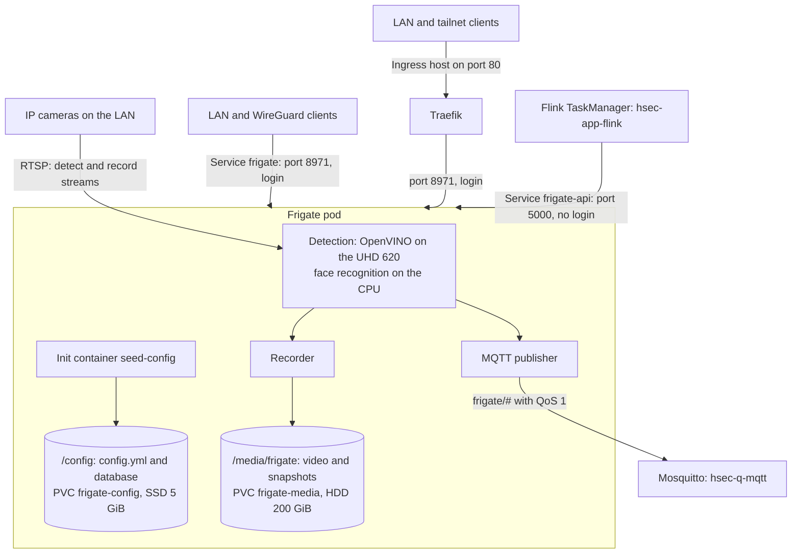

# hsec-app-frigate

Frigate 0.18.0 is the network video recorder (software that records cameras) of the system. It reads the IP cameras, finds people, cars, and faces, and records the video of each detection. It is the only full store of video. It sends what it sees as MQTT messages to Mosquitto (`hsec-q-mqtt`).

## How it works



1. Each camera sends two RTSP streams: a small stream for detection and a full stream for recording.
2. Frigate decodes the detect stream with Intel Quick Sync (hardware video decode) on the Intel UHD 620. OpenVINO finds objects on the same GPU. Face recognition runs on the CPU.
3. Frigate records only the video around alerts and detections, and keeps it for 14 days. Snapshots stay for 30 days.
4. Frigate publishes events, reviews, object updates, and status messages under the MQTT prefix `frigate/`.
5. LAN clients use the web UI on port 8971, which needs a login. They open `http://frigate.<domain>` through Traefik, or `http://192.168.1.17:8971`. Port 5000 has no login. A network policy lets only the Flink TaskManager reach it, for alert snapshots and clips.

## Configuration

`config.seed.yml.tftpl` is the Frigate configuration. Terraform renders it with the namespace and the cameras, and stores it in the ConfigMap `frigate-seed`. On each start, the init container `seed-config` copies the file to `/config/config.yml`. So Terraform owns the configuration. See [ADR-8](../docs/system-design.md#adr-8-terraform-owns-the-frigate-configuration).

- The pod template has the annotation `hsec/config-sha256`, a hash of the rendered configuration. When you change the template or a camera and apply, Kubernetes starts a new pod with the new configuration.
- A restart removes changes that you make in the Frigate UI. Copy zones and masks from the UI into the template.
- The password `FRIGATE_RTSP_PASSWORD` is not in the ConfigMap, and Frigate reads it at start. If you change only that password, run `kubectl -n hsec rollout restart deploy/frigate` after the apply.

| Section | Value | Reason |
| --- | --- | --- |
| `mqtt` | `mosquitto.<namespace>.svc.cluster.local:1883`, QoS 1 | Mosquitto sends each message again until the bridge has it. |
| `tls` | `enabled: false` | Port 8971 serves plain HTTP, so Traefik can route to it. The login stays. |
| `detectors` | OpenVINO on `GPU` | Object detection on the UHD 620 |
| `model` | SSDLite MobileNet v2, 300 x 300 pixels | The OpenVINO model in the Frigate image |
| `ffmpeg` | `preset-intel-qsv-h264` | Hardware decode of H.264 on Intel Gen 8 to Gen 12 graphics. `preset-vaapi` failed about every 9 minutes on the UHD 620 with `Failed to sync surface`. |
| `face_recognition` | `small` model | Runs on the CPU |
| `record` | Alerts and detections 14 days, other video 0 days | Only video with a detection stays. |
| `snapshots` | 30 days | The retention limit of the system |
| `cameras` | One entry per camera, detection on at 5 fps | From the Terraform variable `cameras`. Frigate 0.18 turns detection off by default, so each camera sets `detect.enabled: true`. |

The camera URLs contain the text `{FRIGATE_RTSP_PASSWORD}`, and the MQTT login uses `{FRIGATE_MQTT_USER}` and `{FRIGATE_MQTT_PASSWORD}`. Frigate replaces them with environment variables from the Secret `frigate-env`. So no password is in the configuration file.

If OpenVINO fails on the UHD 620, change `device: GPU` to `device: CPU` in the template. Then apply and restart Frigate.

## Kubernetes objects

| Object | Name | Purpose |
| --- | --- | --- |
| ConfigMap | `frigate-seed` | The configuration that the init container copies on each start |
| PVC | `frigate-config` | `/config` on the SSD class, 5 GiB: configuration, database, and models |
| PVC | `frigate-media` | `/media/frigate` on the HDD class, 200 GiB: recordings and snapshots |
| Deployment | `frigate` | One pod with the `Recreate` strategy, 3 GiB of memory, 1 CPU, and one Intel GPU |
| Service | `frigate` | Type `LoadBalancer` (k3s ServiceLB) on ports 8971, 8554, and 8555 |
| Service | `frigate-api` | Type `ClusterIP` on port 5000, for Flink |
| Ingress | `frigate` | Class `traefik`, host `ingress_host` to the Service `frigate` on port 8971, plain HTTP |

The port 8971 of the Service `frigate` has the name `http`. Traefik uses HTTPS to a port with the name `https`. See [Web UIs](../docs/specs.md#web-uis) in the specs.

The pod also mounts two folders in memory: `/dev/shm` (512 MiB) and `/tmp/cache` (1 GiB). They count toward the 3 GiB memory limit. The startup probe gives the first start up to 10 minutes, because Frigate downloads its models then. On the first start, Frigate prints the admin password in its log.

## Files

```text
hsec-app-frigate/
├── README.md
├── config.seed.yml.tftpl        # starting Frigate configuration
└── terraform/
    ├── versions.tf              # Terraform and provider versions
    ├── variables.tf             # module inputs, with checks on the cameras
    ├── main.tf                  # ConfigMap, PVCs, Deployment, and Services
    └── tests/
        └── frigate.tftest.hcl   # terraform test with a mock provider
```

## Deploy

- Terraform root: `terraform/020-app`. Apply `terraform/010-workload` first, because it creates the Secret `frigate-env` and Mosquitto.
- GPU: the cluster must offer the resource `gpu.intel.com/i915`. The k3s setup of the cluster installs the Intel GPU device plugin that offers it.
- Module inputs: `namespace`, `labels`, `ssd_storage_class`, `hdd_storage_class`, `timezone`, `env_secret_name`, `ingress_host`, and `cameras`.
- A camera name can use only letters, digits, `_`, and `-`. The detect width and height must be greater than 0.

## Test

In `terraform/`, run `terraform init -backend=false` and then `terraform test`. The tests cover the rendered configuration, the pod, the volumes, the Services, the Ingress, and the camera checks.

## Details

See [Frigate](../docs/specs.md#frigate) and [Network policies](../docs/specs.md#network-policies) in the specs.
